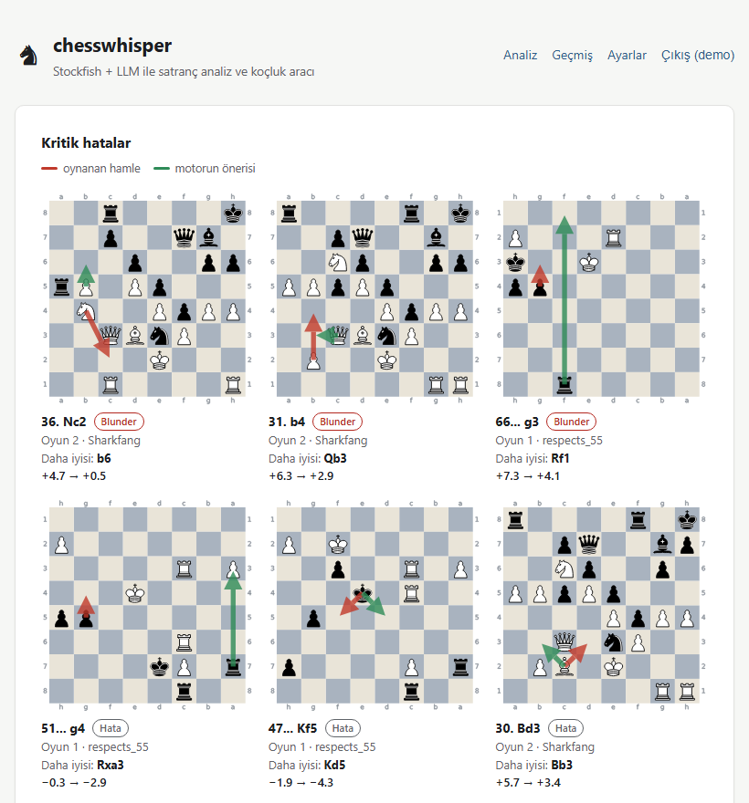

# chesswhisper

[](https://github.com/Caglar-Coban/chesswhisper/actions/workflows/ci.yml)


chesswhisper analyzes your chess games with Stockfish and turns the raw
engine numbers into a coaching report: accuracy and average centipawn loss,
where in the game your mistakes happen, how your openings are going, whether
you crack under time pressure, and, if you want it, a written summary from
Claude or OpenAI.

It runs as a command-line tool that writes a Markdown report, or as a small
multi-user web app with saved history, a progress trend chart and board
diagrams of your worst moves.



## Features

- **Engine analysis.** Every position is evaluated with Stockfish, which is
  downloaded automatically on first use (or uses one you already have).
- **Your stats, not the game's.** Accuracy, ACPL, and inaccuracies, mistakes
  and blunders split by opening, middlegame and endgame, for the player you
  pick.
- **Opening repertoire.** Games are matched against an ECO table, with your
  win/loss/draw record per opening.
- **Time management.** When the PGN has clock data (`[%clk]`), it compares
  your error rate under 30 seconds with the rest of the game.
- **Games straight from Lichess or chess.com.** Give a username instead of a
  file and chesswhisper fetches that player's latest public games.
- **Optional coaching commentary** from Claude or OpenAI, in Turkish or
  English.
- **Web UI** with accounts, encrypted per-user API keys, analysis history,
  a live progress page, an accuracy/ACPL trend chart and critical-move
  boards.

## Quick start

Requires Python 3.11 or newer.

```
git clone https://github.com/Caglar-Coban/chesswhisper.git
cd chesswhisper
pip install ".[web]"         # or just "." for the CLI alone

chesswhisper analyze --lichess YourLichessName --max 10 --lang en -o report.md
```

The first run downloads Stockfish (about 100 MB) into chesswhisper's data
directory. At the default 0.3 seconds per position, a typical game takes
20-40 seconds to analyze.

## Command line

Analyze a PGN file:

```
chesswhisper analyze games.pgn --player "YourName" --lang tr --llm claude -o report.md
```

Or fetch recent games instead of passing a file:

```
chesswhisper analyze --lichess YourLichessName --max 20 --lang en -o report.md
chesswhisper analyze --chesscom YourChessComName --llm claude
```

| Option | What it does |
|--------|--------------|
| `PGN_PATH` / `--lichess USER` / `--chesscom USER` | Where the games come from. Give exactly one. |
| `--max N` | With `--lichess`/`--chesscom`: how many recent games to fetch, 1-50 (default 10). Only public, standard-chess games are used. |
| `--player NAME` | Whose moves to analyze, matched against the PGN's `White`/`Black` headers (case-insensitive). Defaults to the fetched username, or to the name that appears in the most games of the file. |
| `--lang {tr,en}` | Report language (default `tr`). Opening names stay in their standard English form. |
| `--llm {claude,openai,none}` | Coaching commentary provider (default `none`, stats only). |
| `-o, --output PATH` | Where to write the Markdown report (default `report.md`). |
| `--movetime MS` | Engine think time per position in milliseconds (default 300). |
| `--depth N` | Fixed search depth instead of a time limit. |
| `--engine-path PATH` | Use this Stockfish binary instead of downloading one. |

`chesswhisper --version` prints the installed version.

### API keys

`--llm claude` reads `ANTHROPIC_API_KEY` and `--llm openai` reads
`OPENAI_API_KEY` from the environment. You can also put them in a `.env`
file in the directory you run chesswhisper from:

```
ANTHROPIC_API_KEY=sk-ant-...
OPENAI_API_KEY=sk-...
```

`.env` is in `.gitignore`; never commit it. If the LLM call fails, you still
get the stats-only report and a warning.

## Web UI

```
pip install ".[web]"
chesswhisper create-admin          # prompts for a username and password
chesswhisper serve                  # http://127.0.0.1:8000
```

Anyone who can reach the server can register an account. Each user stores
their own Anthropic/OpenAI key under **Settings** (encrypted at rest, and
removable at any time) and can change their password there. The interface
is in Turkish; reports can be generated in Turkish or English.

On the **Analyze** page you upload a PGN (up to 5 MB) or type a Lichess or
chess.com username and choose how many recent games to fetch. You then land
on a progress page that counts games as they're analyzed and opens the
report when it's done; it's safe to leave and come back later from
**History**. Each user runs one analysis at a time.

<p>
  
  
</p>

**History** lists every past analysis and opens with a trend chart of
accuracy and ACPL over time for one player. Hover or use the arrow keys to
read each point, and click one to open that report. Reports start with up
to 12 of the analysis's costliest blunders and mistakes drawn on boards: the
move played as a red arrow, the engine's preferred move as a green one, and
the evaluation before and after.

The admin account also gets an **Admin** page listing every user, where it
can view anyone's history, reset a password (which also lifts a login
lockout) or delete an account.

Security details: passwords are hashed with bcrypt, accounts lock for 15
minutes after 5 failed logins, and every form is CSRF-protected. The server
binds to `127.0.0.1` by default and is meant for you and a few people you
trust, not for the open internet (no HTTPS of its own, no rate limiting, no
email verification). To run it as a service, reach it from other machines,
back it up or upgrade it, see the
[deployment guide](docs/deployment.md).

## How the numbers are computed

- **Centipawn loss** is how much the engine's evaluation drops, from the
  mover's point of view, between the position before and after a move.
  Evaluations are capped at ±10 pawns first, as Lichess does, so missing a
  mate while still a queen up doesn't count as a 99,000-centipawn loss.
- **Classification:** a loss of 50+ cp is an inaccuracy, 100+ a mistake,
  300+ a blunder.
- **Accuracy** converts evaluations to winning chances and scores each move
  by how much of them it gave away, using Lichess's published formula, then
  averages over your moves.
- **Phases:** the first 20 plies are the opening; after that it's an endgame
  once the queens, rooks and minor pieces left on the board are worth 20
  points or less (Q=9, R=5, B=N=3), and a middlegame otherwise. Games
  starting from a custom FEN are classified by material only.
- **Time pressure** means under 30 seconds on your clock when you moved.

## Configuration

| Environment variable | Purpose |
|----------------------|---------|
| `ANTHROPIC_API_KEY`, `OPENAI_API_KEY` | LLM keys for the CLI (the web UI uses per-user keys instead). |
| `CHESSWHISPER_STOCKFISH_PATH` | Use this Stockfish binary. A `stockfish` on `PATH` is also picked up. |
| `CHESSWHISPER_DATA_DIR` | Where to keep the downloaded Stockfish and the web UI's database and keys. Defaults to the per-user data directory (`~/.local/share/chesswhisper` on Linux, `%LOCALAPPDATA%\chesswhisper\chesswhisper` on Windows). |

## Development

```
pip install -e ".[dev,web]"
ruff check src tests   # lint
mypy src               # type-check
pytest                 # tests
```

CI runs all three on every push and pull request, on Linux and Windows with
Python 3.11, 3.12 and 3.13. A smoke test against a real Stockfish runs when
one is on `PATH`.

The web UI's SQLite schema is managed by Alembic. Migrations live in
`src/chesswhisper/web/migrations/versions/` and run automatically when the
app starts. To change the schema:

```
alembic upgrade head                           # bring the scratch dev.db up to date
# edit src/chesswhisper/web/models.py
alembic revision --autogenerate -m "what changed"
```

Review the generated file before committing it; `pytest` fails if the models
and the migrations disagree.

### Project layout

```
src/chesswhisper/
  cli.py              command-line entry point and the shared analysis pipeline
  pgn_loader.py       PGN parsing
  game_sources.py     Lichess / chess.com fetching
  engine_provision.py finding or downloading Stockfish
  engine_analyzer.py  per-move engine evaluations
  stats_engine.py     accuracy, ACPL, phases, openings, time pressure, critical moves
  report_writer.py    Markdown report (with i18n.py for Turkish/English)
  llm/                Claude / OpenAI commentary
  web/                FastAPI app, templates, models and migrations
docs/
  deployment.md       running the web UI as a service
  superpowers/        design specs and implementation plans for each feature
```

See [CHANGELOG.md](CHANGELOG.md) for what changed between versions.

## License

MIT, see [LICENSE](LICENSE).
